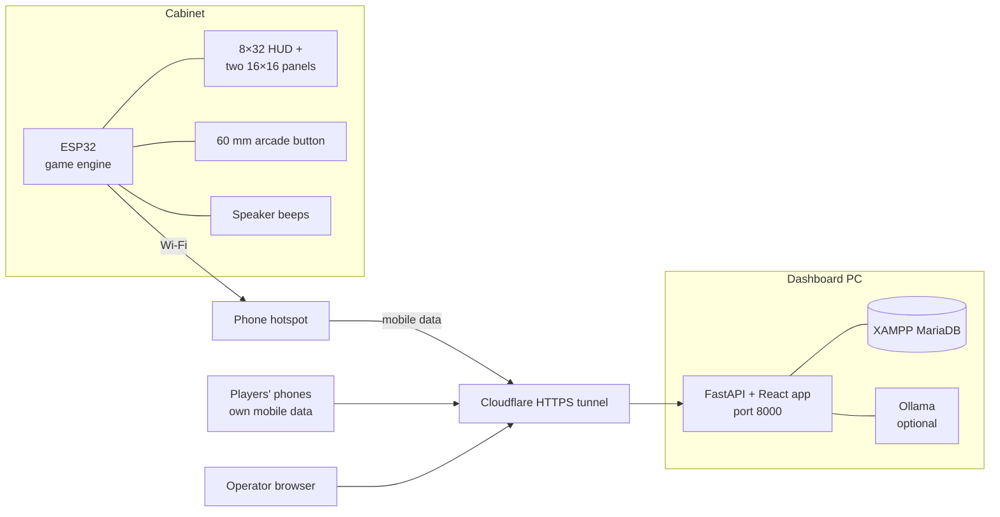

# Stack Moko Baby

**An IoT LED-matrix stacking game for the ACS Carnival, with a private phone queue and an operator dashboard.**


Players scan a QR code with their own phone, register with a nickname and student ID, and wait in a first-come, first-served line. When the cabinet is free, an operator calls the next player. That player presses the big arcade button to drop each moving row onto the stack on the LED panels: 15 levels, 60 seconds, one point per level. The result appears on their phone and unlocks the leaderboard.

The **ESP32 runs the game itself**, so button timing never waits for the network. The **server owns the queue** and saves a score only after replaying the cabinet's placement record.

> **Status, 24 November 2026.** The software passes its automated backend, frontend and browser tests. A 5-minute rehearsal with 60 simulated phones and back-to-back rounds passed on the PC and through a real Cloudflare tunnel (0 errors, 95% of requests under 0.65 s). **The physical cabinet, real phones and the phone hotspot have not been tested yet.** See [what is left before the event](docs/remaining-work.md).

---

## Contents

- [How it works](#how-it-works)
- [Features](#features)
- [Technology](#technology)
- [The cabinet hardware](#the-cabinet-hardware)
- [Getting started](#getting-started)
- [Running the event](#running-the-event)
- [Command reference](#command-reference)
- [Staff accounts and roles](#staff-accounts-and-roles)
- [Configuration](#configuration)
- [Testing](#testing)
- [Repository layout](#repository-layout)
- [Documentation](#documentation)
- [Security and privacy](#security-and-privacy)
- [Known limitations](#known-limitations)
- [Contributing](#contributing)

## How it works



1. **Scan.** The operator shows the Registration QR from the dashboard on a screen. A player scans it with the phone camera (or uploads a photo of it).
2. **Register.** Nickname and student ID. The student ID is encrypted and never shown again. The player gets a private ticket with their place in line.
3. **Call.** When the cabinet reports "ready", the operator presses **Call next player**. The ticket says it is their turn and the HUD shows `NEXT PLAYER`.
4. **Play.** The button starts a 3-2-1 countdown. Each press drops the moving row; any part hanging over the stack is cut off, so the row gets narrower. A complete miss or the 60-second timer ends the round.
5. **Result.** The cabinet uploads its placement record; the server replays it, saves the score, and the player's phone shows the result and the leaderboard.

All cabinet traffic is outgoing HTTPS, so neither the phone hotspot nor the router needs port forwarding.

## Features

**For players**
- Camera or photo QR scanning; registration needs a code the server has just checked, so a copied link alone is not enough.
- A private ticket that survives refreshes, live position updates, a "your turn" alert and the result with leaderboard access.
- If the ticket is lost (new phone, cleared browser, or a restart that changed the address), the operator can give a one-time **re-entry QR**.
- **Stack Intelligence for players:** ask how to play, how long the line is, today's top score, "When is my turn?" or "How did I do?" in English or Taglish, before joining and while waiting. Answers come from checked templates and live data (no AI model), show their source, and never expose other players or student IDs.
- A live line strip on the scan page: people in line, cabinet status and the estimated wait.

**For operators and administrators**
- Light and dark dashboard: Overview, Analytics, Queue, Sessions, Machine and Settings.
- Queue controls: call next, skip with a reason, pause or open admissions, **Player didn't come** (frees the cabinet only after it confirms the round never started) and **re-entry QR**.
- Machine page: last heartbeat, signal strength, command delivery and guarded recovery after a power loss (release, void or recover a result, each audited).
- **Staff accounts:** separate operator logins for booth helpers; only an administrator can change scores, accounts or assistant training.
- **Stack Intelligence (staff):** a local, read-only English/Taglish assistant that answers questions about the event from saved data (optional; needs Ollama).
- A development simulator for testing the full flow without a cabinet; simulator scores are labelled and ranked separately.

**Reliability**
- Live updates over authenticated WebSockets with a polling fallback.
- Boot-bound device journal: a round interrupted by a power cut is never resumed or scored automatically.
- Encrypted automatic backups (at start, every 15 minutes, on Ctrl+C) with a verified restore.
- The launcher starts XAMPP MySQL if needed and restarts it if it stops.
- The cabinet follows a new tunnel address over USB without reflashing.

## Technology

| Layer | Stack |
|---|---|
| Frontend | React 19 (JavaScript/JSX), Vite 8, Tailwind CSS 4, React Router 7, Radix UI, Recharts, html5-qrcode, qrcode.react, Font Awesome, Open Sans Variable |
| Backend | Python 3.13, FastAPI, SQLAlchemy Core, PyMySQL, Argon2id (pwdlib), cryptography (AES-GCM, Fernet) |
| Database | XAMPP MySQL service (MariaDB 10.11), versioned SQL migrations |
| Cabinet | ESP32 (Arduino core), Adafruit NeoPixel, ArduinoJson, NVS journal, HTTPS client |
| Hosting | This PC plus a free Cloudflare Quick Tunnel (`npm run online`) |
| Assistant | Local Ollama (`qwen3:4b-instruct` by default), optional |
| Tests | pytest, Vitest + Testing Library, Playwright with axe accessibility checks |
| Project map | [Graphify](docs/graphify-setup.md) knowledge graph in `graphify-out/` |

## The cabinet hardware

| Part | Connection |
|---|---|
| ESP32 DevKit | Powered and programmed from laptop USB port 1 |
| 8×32 WS2812 matrix (HUD, top) | First on the data line: GPIO18 → 330 Ω → DIN |
| Two 16×16 WS2812 panels (blocks, below) | Chained after the HUD; 5 V fed to each panel from laptop USB port 2 |
| 60 mm LED arcade button | Switch COM → GND, NO → GPIO27; its light on the 5 V lead |
| Speaker | GPIO26 → 220 Ω → speaker → GND (beeps generated by the firmware) |

The laptop is the only power source, so the firmware caps LED current (`STACK_LED_BUDGET_MA`, 400 mA by default). The full illustrated wiring, self-test and operating guide is the **[Wiring and Operation Guide (PDF)](docs/Stack-Moko-Baby-Wiring-and-Operation-Guide.pdf)**. Firmware details: [firmware/README.md](firmware/README.md).

## Getting started

### Prerequisites (Windows)

- [Node.js](https://nodejs.org/) 22.12 or newer
- [Python 3.13](https://www.python.org/downloads/windows/)
- [XAMPP](https://www.apachefriends.org/) (for MySQL/MariaDB)
- Optional: [Ollama](https://ollama.com/) for Stack Intelligence; [arduino-cli](https://arduino.github.io/arduino-cli/) is used by the flashing scripts

### Install once

Start **MySQL** in the XAMPP Control Panel, then:

```powershell
cd D:\iot-dashboard
npm --prefix frontend ci
python -m venv backend\.venv
.\backend\.venv\Scripts\python.exe -m pip install -r backend\requirements.txt
.\backend\.venv\Scripts\python.exe backend\setup_local.py
```

`setup_local.py` creates the project database, applies the migrations, creates a restricted application account and generates local secrets in `backend/.env`. Re-running it applies new migrations and keeps existing data and passwords. The administrator login is written to `backend/.admin-credentials.txt`. Keep both files private. If your XAMPP `root` account has a password, see [backend setup](backend/README.md).

### Run locally

```powershell
cd D:\iot-dashboard
npm run dev
```

This starts FastAPI on port 8000, waits until the API and database are ready, then starts Vite on port 5173. Open <http://localhost:5173/admin/login>. Ctrl+C stops what it started.

**No cabinet yet?** In **Queue**, use the development simulator: **Set simulator ready → Call next player → Start test round → Finish: win / loss**. More detail and troubleshooting: [local setup](docs/local-setup.md).

## Running the event

| When | What to do |
|---|---|
| **Day before** | On the event laptop: `npm run event:check` (add `-- --fix-power` to stop sleep, lid and USB power-saving). `npm run db:verify`. Copy `backend/.env` to a USB drive kept apart from the laptop. Install Windows updates, then pause them. |
| **First start / after a firmware or Wi-Fi change** | Set the hotspot name and password for this PowerShell window, then `npm run online:device` (builds, opens the tunnel and flashes the cabinet over USB without erasing its journal). |
| **Every later start** | `npm run online`. It prints the **Admin** and **Player scanner** links and sends the new address to the cabinet over USB. Keep the window open. |
| **During the event** | Show the Registration QR from **Overview** on a screen. Run the line from **Queue**. Helpers use their own operator accounts. |
| **After the event** | Ctrl+C (final backup). `npm run db:purge-ids` to see the count, then `npm run db:purge-ids -- --all --apply` to delete stored student IDs; scores stay. |

```powershell
# first time on a new hotspot (values stay in this window only)
$env:STACK_FIRMWARE_WIFI_SSID = "YOUR-HOTSPOT-NAME"
$env:STACK_FIRMWARE_WIFI_PASSWORD = "YOUR-HOTSPOT-PASSWORD"
npm run online:device
```

The free Quick Tunnel gives a new address on every start and, per Cloudflare, has no uptime guarantee and handles up to 200 requests at once (plan for fewer than about 150 phones with the ticket open at the same time). See [free online operation](docs/free-online.md) and [physical bring-up](docs/hardware-bringup.md).

## Command reference

Run from the project root.

| Command | Purpose |
|---|---|
| `npm run dev` | Local development: API and Vite together |
| `npm run dev:backend` / `npm run dev:frontend` | Start one side only |
| `npm run online` | Event mode: build, Cloudflare tunnel, API on the real database, backups, cabinet address over USB |
| `npm run online:device` | As above, and flash the hotspot-configured firmware to the cabinet |
| `npm run online:firmware` | As above, but build a private firmware image (Wokwi) instead of flashing |
| `npm run device:selftest` | Flash the wiring self-test (displays, button, speaker) |
| `npm run device:flash` | Flash firmware only |
| `npm run device:url` | Send the current tunnel address to the cabinet over USB |
| `npm run db:backup` | Manual encrypted backup (kept outside the project) |
| `npm run db:verify` | Restore the newest backup into a throwaway database and compare row counts |
| `npm run db:purge-ids` | Student-ID retention: dry run by default; `-- --all --apply` after the event |
| `npm run event:check` | Event-laptop readiness report; `-- --fix-power` fixes power settings |

## Staff accounts and roles

| Role | Can do |
|---|---|
| **Operator** | Overview, Sessions, Analytics; call next, skip, pause or open admissions, Player didn't come, re-entry QR; request a device stop, hold a round for review, release a no-show; Stack Intelligence chat |
| **Administrator** | Everything an operator can, plus void or recover an interrupted round's score, the simulator, practice-question review and assistant training, and **Settings → Staff accounts** |

An administrator creates operator accounts in Settings; each gets a server-generated password shown once. Resetting a password or switching an account off signs that operator out immediately.

## Configuration

`setup_local.py` writes `backend/.env`; you rarely need to edit it. Useful settings (names only; never commit values):

| Variable | Meaning |
|---|---|
| `STACK_PUBLIC_URL`, `STACK_ALLOWED_ORIGINS` | The public address(es) the app accepts; set automatically by `npm run online` |
| `STACK_SIMULATOR_ENABLED` | `false` hides the development simulator |
| `STACK_AI_ENABLED`, `STACK_OLLAMA_URL`, `STACK_OLLAMA_MODEL` | Stack Intelligence |
| `STACK_BACKUP_MINUTES`, `STACK_BACKUP_DIR`, `STACK_BACKUP_KEEP` | Automatic backups (default every 15 min, outside the project) |
| `STACK_XAMPP_DIR` | XAMPP location if not `C:\xampp` |
| `STACK_LED_BUDGET_MA` (firmware, `display_layout.h`) | LED current cap for laptop USB power |

## Testing

All tests use generated throwaway databases and never touch event data.

```powershell
# backend (from backend\)
.\.venv\Scripts\python.exe -m pytest tests -q
# frontend unit tests and build (from frontend\)
npm test
npm run build
# real-browser journeys on dedicated ports 8001/5174 (from backend\)
.\.venv\Scripts\python.exe run_browser_tests.py
# event load rehearsal: 60 phones for 5 minutes (add --tunnel for the real internet path)
.\.venv\Scripts\python.exe rehearse_event.py
```

Latest results (24 November 2026): **488** backend tests passed; **59** frontend unit tests passed; **13** browser journeys passed with the Matrix journey skipped by design (it needs `STACK_TEST_RULESET=matrix-v1`); the camera-scanner journey has timed out intermittently in long full runs and passes on its own. Two offline NLP-lab test files need the separate NLP-lab environment. Rehearsal: 60 phones, 0 errors on loopback and through a real tunnel.

## Repository layout

```text
backend/     FastAPI app (app/), SQL migrations, tests, setup, emulators, rehearsal and quality tools
frontend/    React app (src/pages, src/components, src/state), Vitest tests, Playwright e2e/
firmware/    ESP32 sketch stack_moko_baby/ (game engine, display layout, sounds, Wokwi diagram)
scripts/     Launchers (dev, online), device flashing, backups, ID purge, event check, Graphify
contracts/   Example JSON for the device, game-result and assistant contracts; Matrix v1 rules
docs/        Specifications, setup and operation guides, the PDF guide, evaluation records
deploy/      Inactive Render/MariaDB alternative (used with the root Dockerfile and render.yaml)
graphify-out/ Generated project knowledge graph
```

## Documentation

Start with **[docs/README.md](docs/README.md)**, the full documentation index. Most useful:

| Topic | Document |
|---|---|
| Wiring, self-test and event operation (printable) | [Wiring and Operation Guide (PDF)](docs/Stack-Moko-Baby-Wiring-and-Operation-Guide.pdf) |
| Physical cabinet bring-up | [hardware-bringup.md](docs/hardware-bringup.md) |
| Event hosting with the tunnel | [free-online.md](docs/free-online.md) |
| Player flow, access and roles | [player-flow-and-access.md](docs/player-flow-and-access.md) |
| What is left, ranked by event risk | [remaining-work.md](docs/remaining-work.md) |
| Backups, restore and student-ID purge | [backups.md](docs/backups.md) |
| Daily development and troubleshooting | [local-setup.md](docs/local-setup.md) |
| Architecture and database | [tech-stack.md](docs/tech-stack.md), [schema.md](docs/schema.md) |
| Device protocol and recovery | [esp32-online.md](docs/esp32-online.md), [device-recovery.md](docs/device-recovery.md) |
| Stack Intelligence | [admin-assistant.md](docs/admin-assistant.md) |

## Security and privacy

- **Student IDs** are required but private: looked up by a keyed HMAC, stored encrypted with AES-256-GCM, never returned by any API, never put in URLs, browser storage, logs, the knowledge graph or the assistant. `npm run db:purge-ids` deletes them after the event.
- **Sessions:** separate HttpOnly, SameSite=Strict cookies for players and staff, CSRF tokens on every change, same-origin checks, Argon2id staff passwords, and a login limit of 8 failures per visitor and username in 15 minutes (the visitor's real address is used behind the tunnel).
- **Scores** are never accepted from a browser. The cabinet authenticates with a device token, and the server recomputes each score from its placement record.
- **Audit log:** skips, no-shows, recoveries, re-entry codes, staff account changes and ID purges are recorded without personal data.
- **Never commit** `backend/.env`, `backend/.admin-credentials.txt`, `firmware/stack_moko_baby/config.h`, backups or exports. All are git-ignored.

## Known limitations

- The cabinet, power on laptop USB, the phone hotspot and real phones are **not yet tested**; game timing values are proposals until play-tested.
- The free Quick Tunnel has no uptime guarantee and changes address on restart; a fixed address needs a domain and a firmware change.
- No push notifications to closed tabs: players keep the ticket page open (the HUD and the operator also call the next player).
- Stack Intelligence is experimental: on its reused 325-question evaluation sets it routes about 61–64% of questions correctly (regression evidence, not fresh accuracy). It is read-only and never changes data.
- One event, one cabinet, one API worker.

## Contributing

Read [AGENTS.md](AGENTS.md) and [docs/README.md](docs/README.md) first. Keep student IDs, credentials, backups and the configured `config.h` out of commits and out of the knowledge graph. After code changes, refresh the graph with `scripts\graphify.cmd update .`. There is no CI; run the tests above before pushing.

This repository does not include a licence file. All rights are reserved by the project authors unless a licence is added.
