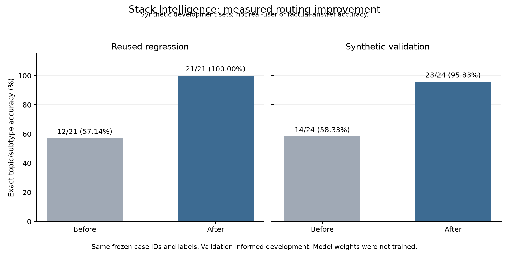
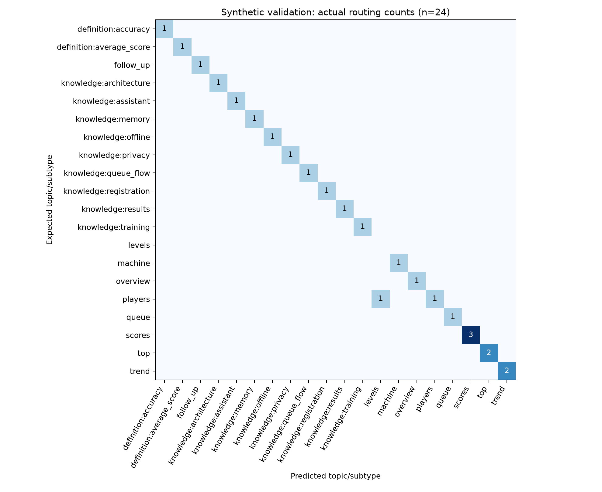

# Measured NLP routing improvement — 20 November 2026

> **Offline experiment:** [five-candidate comparison, actual SetFit training and context diagnostics](offline-lab-20261120.md) now have measured graphs and a separate [implementation guide](../nlp-offline-experiment.md). No candidate is promoted. Those 130 developer-labelled questions are development data; the [candidate collection](candidate-v2-preparation.md) now has 325 AI-authored cases, with independent review and final evaluation pending. Historical results below remain unchanged.

> **Later pipeline repair:** [current implementation and all retained results](../nlp-routing-repair.md) document the v11 public-language/topical-checking pipeline, 406 backend checks, and the explicitly consumed 325-case regression: **135/325 (41.54%)**, 135 valid clarifications and one unsupported false acceptance. Broad reliability is still inadequate. The older measurements below describe their historical predictor versions.

> **Generalization evidence update:** the subsequent [325-case first-use holdout](holdout-v1.md) measured **59/325 accepted intent/context matches (18.15%)**, with 247 valid requests receiving clarification. The 21- and 24-case figures below are historical development results and must not be promoted as general accuracy. The larger test was not used to repair the frozen predictor.

This update improves the local routing pipeline and its project-authored examples. It does not fine-tune model weights, learn facts from raw chat, or modify game scores or private identities. Progress-report files and their historical 12/21 measurement remain unchanged.

## Changes based on observed errors

The baseline confused live values with definitions, queue operation with queue design, simulator status with proof of physical connectivity, and Taglish ranking/trend questions with generic player/score questions. Most failing requests retrieved no examples. Baseline input counts were roughly 856–987 tokens; context truncation was not established as the cause.

- Added **42 synthetic contrastive training examples** in `backend/data/assistant-routing-contrasts.json`. They cover value/formula contrasts, operational/design questions, hardware-evidence limits, source separation, ranking, trends, overview and memory. These are routing labels, not live facts or real conversations.
- Retrieval compares approved English/Taglish meaning features and admits relevant short examples. Demonstrations remain limited to three, compatibility-filtered and deduplicated. Evaluation rows are never retrieved.
- Ollama receives role-separated demonstrations and readable approved tokens. Raw chat, removed identifiers, database rows and unvalidated history remain excluded.
- A server-derived `request_kind` distinguishes analytics, definitions and system knowledge. The JSON schema limits topics to an explicit kind; ambiguous requests retain the full ontology. This improves a **constraint-guided routing pipeline**, not the unchanged model's independent ability.
- General semantic rules preserve whole-event summaries, queue ownership explanations, simulator proof limits, source-separation policy and Taglish peak-time requests. Count requests mentioning an operator still request counts. Unknown subjects and action/private requests remain guarded.
- Reviewed public function/memory vocabulary supports phrases such as “including activity” and “remembered context.” Assignment explanations do not enable assignment commands.
- Generated learning labels now match the actual measure: score averages use `scores`, and whole-event summaries use `overview`. Correct tools with contradictory saved labels would otherwise reinforce later routing errors.

Normalization is `system-context-v9-contrastive-routing`. Prompt/corpus fingerprints change, so stale private example approvals require explicit re-review. Ownership, memory opt-out and forgetting remain enforced.

## Measured results

Local model: `qwen3:4b-instruct`, Qwen3 4.0B, Q4_K_M. The baseline was rerun before changes. Predictions below came from actual local Ollama calls.

| Set | Before | After | Limits |
|---|---:|---:|---|
| Existing regression | 12/21, 57.14% | 21/21, 100.00% | Reused development cases, including the known motivating errors. |
| Frozen synthetic validation | 14/24, 58.33% | 23/24, 95.83% | Developer-authored validation inspected during development; not a blind independent test. |

The metric is exact topic plus relevant subtype before final backend intent resolution and factual tools. Before/after case IDs, labels and dataset SHA-256 hashes match. Refusals and inference errors remain in the denominator. The final evaluator applies the application's unknown-context gate; all final validation inputs passed it, so that final count also matches their raw model classifications.

The baseline raw validation run bypassed the unknown-word gate. Auditing its stored predictions with the historical v8 normalizer gives **13/24 guard-aware classifications**, versus 14/24 raw classifications. Neither is end-to-end chatbot accuracy. A correct raw activity-summary label could also be followed by a wrong backend trend override; that overview constraint was fixed separately.





One raw classifier error remains: validation-03 requests pooled overlap percentage for the whole event, but predicts `levels` instead of `players`. The backend selects `get_event_summary` for it. This is still counted as an incorrect classification; it is not removed or relabelled.

Small synthetic sets do not establish representative real-user accuracy, independent test performance or overall factual-answer accuracy. The next release evaluation needs fresh, independently reviewed English/Taglish cases. Synthetic volume alone is not evidence of improvement.

## Evidence and verification

- [Case-level results](results/) retain labels, errors, latency, token counts and dataset hashes. [Comparison JSON](comparison.json) and [plot source](plot_metrics.py) compute values from the measured results and assert matching cases/hashes.
- `backend/evaluate_routing.py` uses no database/private memory, rejects exact normalized train/evaluation duplicates, applies guards and refuses to overwrite an artifact. Current runs record prompt, normalization and runtime-corpus versions.
- `backend/tests/test_routing_quality.py` covers wrong-model invariance, label consistency, vocabulary, action/privacy boundaries, demonstration roles, evaluation isolation and actual API overview/design responses with disposable XAMPP data.
- The actual local-model integration regression passed **44/44** synthetic cases, checking conversations, tool selection, scopes and denials. This is regression evidence, not general accuracy.
- Final full backend regression: **323 passed**, including all 17 new focused routing checks and disposable XAMPP integration cases. Ruff E9/F821/F822/F823 checks passed. The upstream Starlette/TestClient deprecation warning remains. No browser or physical hardware check is claimed for this backend-only change.

From the project root, with Ollama running, choose new output paths:

```powershell
.\backend\.venv\Scripts\python.exe backend/evaluate_routing.py --output .tools/evaluations/routing-new-run.json
.\backend\.venv\Scripts\python.exe backend/evaluate_routing.py --dataset backend/data/assistant-routing-validation.json --split validation --output .tools/evaluations/validation-new-run.json
```

Runtime dependencies are unchanged. Plotting uses a separate documentation environment with Matplotlib/scikit-learn. Generated results/plots are excluded from Graphify; this explanation is indexed.

## Research basis

[Ollama structured outputs](https://docs.ollama.com/capabilities/structured-outputs) supports schema-constrained validated outputs; valid JSON does not prove semantic correctness. [Scikit-learn leakage guidance](https://scikit-learn.org/stable/common_pitfalls.html) motivates separate evaluation inputs. [Google dataset guidance](https://developers.google.com/machine-learning/crash-course/overfitting/dividing-datasets) explains training/validation/test separation and repeatedly inspected sets. Vocabulary, kind constraints, synthetic contrasts and read-only facts are project decisions.
