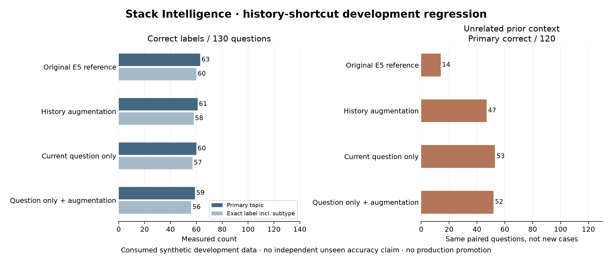

# History shortcut: offline representation and training experiment

20 November 2026. **Consumed development regression only; no live model replacement.** This follow-on investigates the shortcut found in the [first experiment](offline-lab-20261120.md). It preserves that run, the original 325-case benchmark and the live assistant.

## Fixed comparison

The original 285 admitted training rows yield 1077 rows after label-preserving history augmentation. These are 792 variants of existing training questions, **zero newly independent questions**. Three different typed prior subjects are added only to original training rows without a previous subject. Existing contextual/follow-up rows retain their actual subject. Family membership and the original train/calibration boundary remain intact.

The encoder remains frozen multilingual E5. All candidates fit balanced hierarchical logistic heads. One uses augmented history-bearing inputs; one classifies the current question only on the original training rows; one combines current-question classification with augmentation. Typed state remains available to a separate reducer after classification. No candidate runs factual tools, changes game data or trains Ollama weights.

The protocol, augmentation, code and protected runtime hashes were frozen before these predictions. Confidence temperature and operating points use only the original calibration set. The same 130 inspected questions and paired 120-question misleading-history diagnostic are reused explicitly as regression data.

| Candidate | Primary / 130 | Exact label / 130 | Context stress primary / 120 | Labels changed under added history / 120 |
|---|---:|---:|---:|---:|
| Original frozen E5, first experiment | 63/130 | 60/130 | 14/120 | See first experiment |
| e5-history-augmented | 61/130 | 58/130 | 47/120 | 19/120 |
| e5-question-only | 60/130 | 57/130 | 53/120 | 0/120 |
| e5-question-only-augmented | 59/130 | 56/130 | 52/120 | 0/120 |

## Coverage, exactness and limitations

History augmentation improved the reused context-stress count from 14/120 to 47/120, but ordinary primary matches fell from 63/130 to 61/130. Question-only classification removed history-induced label changes by construction, while reaching only 60/130 primary matches and answering one supported question under its calibrated policy. None is adequate for promotion.

The original frozen development inputs also show 40/120 supported questions blocked before classification. Across all 130 questions, the recorded gate outcomes are 84 admitted, 31 unrecognized-context, 14 system-scope and one unsupported-measurement. Even perfect classification of admitted inputs cannot repair those supported refusals. The next design review must separate privacy/control refusal, unsupported meaning and unfamiliar wording without exposing identifiers or removing guards blindly.

| Candidate | Supported answered / 120 | Primary correct among answered | Exact among answered | OOS false accepts: raw / policy (out of 10) |
|---|---:|---:|---:|---:|
| e5-history-augmented | 0/120 | N/A (no answers) | N/A (no answers) | 3 / 0 |
| e5-question-only | 1/120 | 1/1 | 1/1 | 4 / 0 |
| e5-question-only-augmented | 0/120 | N/A (no answers) | N/A (no answers) | 4 / 0 |

Question-only history invariance is an architectural property, not proof of understanding. A consistently wrong answer is still wrong. Primary topics alone do not validate subtype, filters, resolved context, tool choice or factual correctness. The prototype has not replaced the live state resolver.

Synthetic augmentation assumes the source label survives unrelated history; those assumptions still need review. It adds no language diversity, missing definition subtypes or independently authored intent families. Duplicating training rows can also affect regularization; the question-only with/without augmentation comparison exposes that difference. The small, already inspected regression cohort cannot establish unseen generalization or justify production promotion.

At this experiment’s run time, the 325-slot collection was still empty. The [later preparation milestone](candidate-v2-preparation.md) filled all 325 AI-authored candidate questions and completed automated overlap checks; independent review is still pending. Next: independently reviewed rare-class/new-topic/follow-up families, new separate development validation and a frozen independent final evaluation before any promotion.

## Evidence

- Retained protocol, variants, candidate heads and predictions: `.tools/nlp-lab/history-lab-20261120-01/`.
- [Case-level summary and hashes](results/history-lab-20261120.json).
- [Experiment code](../../backend/experiment_history.py), [summary generator](summarize_history_lab.py), [plot source](plot_history_lab.py).
- Four new checks verify partition admission, unchanged labels/families, contextual-example preservation and current-question history invariance; all fourteen offline checks passed.
- [Implementation guide](../nlp-offline-experiment.md) and [label guide](../nlp-label-guide.md).
