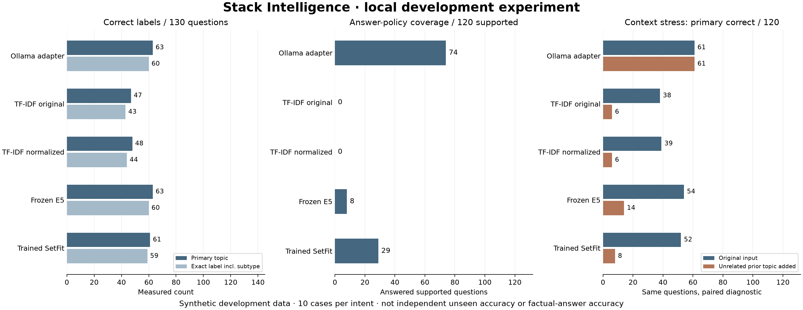

# Local NLP comparison — measured development results

20 November 2026. **Decision: retain the current live router. No experimental model is activated.**

All five candidates ran locally. These are routing labels on 130 new developer-labelled synthetic development questions (ten per primary intent), not independently reviewed unseen test accuracy or factual-answer correctness. The old 325-case benchmark remains consumed regression evidence and was not used as training data.

The baseline adapter maps both refusal and clarification to `unsupported`; stored baseline rows cannot distinguish those statuses. Its label counts are guard-aware routing outcomes, whereas the learned-model label counts use argmax after admission guards. This is a pipeline feasibility comparison, not a controlled claim that one bare model is more accurate.

| Candidate | Primary correct / 130 | Exact label / 130 | Primary macro F1 |
|---|---:|---:|---:|
| Current Ollama routing adapter | 63/130 (48.46%) | 60/130 | 0.514 |
| TF-IDF original | 47/130 (36.15%) | 43/130 | 0.365 |
| TF-IDF normalized | 48/130 (36.92%) | 44/130 | 0.372 |
| Frozen multilingual E5 + heads | 63/130 (48.46%) | 60/130 | 0.520 |
| Trained multilingual SetFit + heads | 61/130 (46.92%) | 59/130 | 0.494 |

Primary accuracy checks the topic; exact labels additionally require a knowledge/social/definition subtype. All guards, refusals and errors remain in the denominator. Ten cases per intent cannot establish reliable per-intent performance. The two-case difference between SetFit and the router is not evidence of a statistically established ranking.

## Coverage and abstention

The learned models select confidence/margin thresholds using calibration data only, targeting at least 90% primary-routing precision and zero calibration out-of-scope false answers. This is an experimental selection target, not a proven safety guarantee. The current Ollama adapter retains its existing guard policy. These policies are different; report coverage alongside precision.

| Candidate | Supported questions answered / 120 | Correct primary among answered | Exact among answered | OOS false accepts: raw / policy (out of 10) |
|---|---:|---:|---:|---:|
| Current Ollama routing adapter | 74/120 | 54/74 | 51/74 | 1 / 1 |
| TF-IDF original | 0/120 | N/A (no answers) | N/A (no answers) | 1 / 0 |
| TF-IDF normalized | 0/120 | N/A (no answers) | N/A (no answers) | 1 / 0 |
| Frozen multilingual E5 + heads | 8/120 | 8/8 | 7/8 | 4 / 0 |
| Trained multilingual SetFit + heads | 29/120 | 27/29 | 25/29 | 3 / 0 |

TF-IDF found no feasible calibration operating point and abstained on every supported question. Frozen E5 answered only eight supported questions. Neither zero false answers nor high precision on a small accepted subset establishes a useful assistant. No metric here evaluates the truth of an answer or database/tool correctness. All five runs recorded zero service errors.

## Misleading-history diagnostic

This post-hoc diagnostic reuses the same 120 non-follow-up questions with unrelated typed prior context. It is not 120 additional independent test cases. Model weights, labels and operating points were not changed.

| Candidate | Primary correct before → after / 120 | Originally correct → wrong | Incorrect follow-up predictions after / 120 |
|---|---:|---:|---:|
| Current Ollama routing adapter | 61 → 61 | 1 | 0 |
| TF-IDF original | 38 → 6 | 32 | 75 |
| TF-IDF normalized | 39 → 6 | 33 | 75 |
| Frozen multilingual E5 + heads | 54 → 14 | 40 | 66 |
| Trained multilingual SetFit + heads | 52 → 8 | 44 | 73 |

The source pool contains 33 context-bearing follow-ups and **zero context-bearing explicit new topics** after deduplication. SetFit predicted follow-up for 73 unrelated new requests; 44 formerly correct primary predictions became wrong. This is a deployment blocker. Add matched explicit-topic-change and genuine-follow-up training families, keeping development and final evaluation separate.

## Data and implementation audit

- Original training material: 515 rows, including 315 social examples, only eight definitions and no unsupported class. Several metric-definition subtypes are absent.
- Sixty lab-only synthetic negative examples were added. The lab removed 76 duplicate copies and quarantined five rows involved in three normalized conflicting pairs; it did not relabel the old benchmark.
- Usable pool: 494 rows across 154 families/groups. Splits: 295 training, 98 calibration, 101 comparison. Of 494 rows, 472 pass current wording guards; blocked rows remain in comparisons.
- The 130 new development inputs have zero exact or high lexical near matches against the source pool under the recorded audit rules. Semantic independence has not been human-adjudicated.
- SetFit genuinely changed encoder weights: 40 contrastive steps on a capped 123-row training subset, then hierarchical heads on admitted training rows. This did not outperform the current router.
- Baseline uses the actual routing path with no-data renderers and train-only retrieval; existing static prompt/social priors predate the split. Its 101 source-comparison cases are seen development. No database or private messages were used.
- The saved XLM-R tokenizer emitted an upstream regex warning. Original and saved tokenizers produced identical encodings on all 250 actual balanced/context input strings. No model-specific regex patch was applied.

## Unknown-word diagnostic

Twenty fixed public synthetic wording probes were checked separately. Original-text counterfactuals bypass only wording gates for these reviewed public probes; privacy/control refusals cannot be bypassed. These rows are not training/calibration or independent evaluation.

| Candidate | Current gate: primary / 20 | Reviewed original-text counterfactual: primary / 20 |
|---|---:|---:|
| TF-IDF original | 5/20 | 9/20 |
| TF-IDF normalized | 5/20 | Not run for normalized tokens |
| Frozen multilingual E5 + heads | 5/20 | 14/20 |
| Trained multilingual SetFit + heads | 4/20 | 11/20 |

The counterfactual shows a wording-gate bottleneck and remaining model error; it does not authorize raw runtime inputs or removal of privacy guards.

## Independent evaluation remains pending

At this experiment’s run time, the collection contained **325 blank slots, zero questions and zero independently approved labels**. It has since been filled with [325 AI-authored candidate questions](candidate-v2-preparation.md), with independent review still pending. It is not a new test dataset. Collect and independently review twenty to fifty diverse cases per intent, audit all previously seen inputs for overlap, and freeze labels, predictor, decoder and scorer before first-use evaluation. The assistant cannot attest that its own generated labels received independent human review.

## Evidence and reproduction

- Frozen local run: `.tools/nlp-lab/intent-lab-20261120-02/`; model artifacts stay local and excluded from Graphify.
- [Case-level measured summary](results/offline-lab-20261120.json) includes all predictions, language breakdowns, source-comparison results, fingerprints and calibration metadata.
- [Offline implementation and commands](../nlp-offline-experiment.md) and [annotation guide](../nlp-label-guide.md).
- [Summary generator](summarize_offline_lab.py), [plot source](plot_offline_lab.py), [paired context diagnostic](audit_lab_context.py).

## Research applied

[SetFit](https://huggingface.co/docs/setfit/v1.1.3/en/conceptual_guides/setfit) separates encoder adaptation from classifier training. [Multilingual E5](https://huggingface.co/intfloat/multilingual-e5-small) documents the query prefix used here. [Scikit-learn calibration guidance](https://scikit-learn.org/stable/modules/calibration.html) motivates disjoint calibration and transparent confidence reporting. Our results do not establish that this limited training recipe exhausts those approaches.
