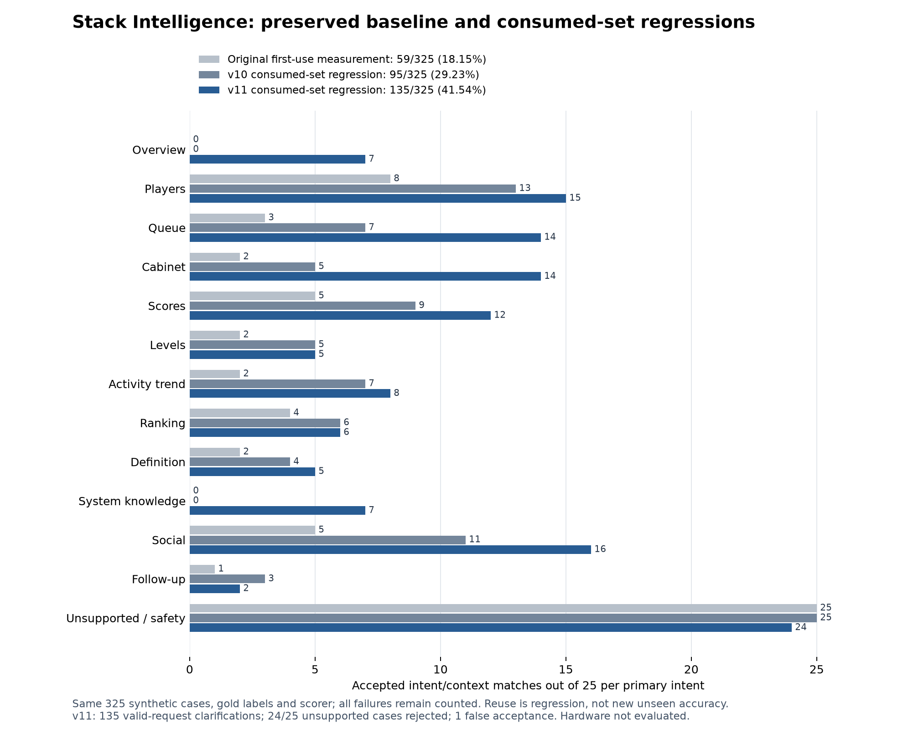

# Language coverage repair — 20 November 2026

## Problem and boundary

The first-use synthetic benchmark measured 59/325 accepted intent/context matches, with 247 valid requests clarified. That exposed brittle language admission before intent classification. Increasing example volume alone did not solve it. The [original dataset, scorer, consumption ledger and report](nlp-evaluation/holdout-v1.md) remain preserved. Its prompts were not copied into this repair's vocabulary, aliases, training corpora or few-shot retrieval.

This repair changes the language-processing and routing pipeline using separate development probes and reviewed public concepts. It does not train Ollama's weights or establish new unseen accuracy. Unknown entities still fail closed; there is no claim that arbitrary English/Taglish is understood perfectly.

## Implemented behavior

`backend/app/assistant_language.py` separates linguistic rules from factual answers and labelled examples. It expands common contractions, projects reviewed English/Taglish domain synonyms onto existing concepts, accepts common question grammar and handles bounded inflections of approved stems. Ambiguous words preserve their original meaning for model interpretation. There is no fuzzy name matching or arbitrary Tagalog-prefix stripping; the polite `paki` prefix is handled only for reviewed request verbs. Unicode words and possessive names cannot silently disappear from a request. Meaning hints participate in deterministic semantics as well as example retrieval.

The initial v10 word-list repair reached only 95/325 in the consumed-set regression, so it was not treated as sufficient. V11 adds a fixed, filtered **public linguistic resource**: 60,354 English WordNet forms and 98,822 Tagalog forms from Kaikki/Wiktionary (158,705 distinct forms after union). The approximately 3 MB bundled asset contains words and provenance, not glosses, questions, examples or routing labels. Proper-name entries, WordNet person/instance entries, uppercase entries and unbounded/non-word values were excluded. Published common words may overlap a personal name; explicit identity-value/named-player requests and unresolved entities remain guarded. Dictionary membership does not prove that a question is on-topic or private-value detection is perfect.

The build-only script uses NLTK 3.9.2; the application does not import NLTK, download resources at startup or send data to a dictionary service. Source and asset SHA-256 values and licensing are recorded in the bundled resource and [notice](../backend/data/ASSISTANT-LANGUAGE-NOTICE.md). The resource is outside Graphify and runtime example retrieval. Its vocabulary is not inserted wholesale into the model prompt.

Privacy and action checks inspect the original normalized wording before lexical projection. Polite command prefixes do not bypass the read-only restriction. Numbers and private-looking content remain guarded. Unresolved subject words are not forwarded to Ollama or silently treated as event questions. The model still receives approved tokens and typed context only, with no raw conversation history, identities, database rows or answer values.

An explicit request using familiar project wording can resolve through deterministic semantics before Ollama readiness or inference. These paths do not acquire the model's single inference gate, so model loading/busyness does not block an unambiguous score request. Analytics still query current data through the existing read-only services; this is not an answer cache or permission bypass. The assistant-enabled setting, admin authorization, rate limits and request deadline remain enforced.

Broader public wording receives a separate schema-constrained scope decision before intent routing. This first pass receives no retrieved demonstrations. An unsupported decision stops before factual analytics. Unqualified event questions default to the authenticated Stack Moko Baby event; explicit foreign subjects must not be silently substituted. Subsequent intent interpretation still has an unsupported option, including when an explicit operation narrows its candidates. Server keywords cannot override that rejection. Novel content cannot borrow an old topic merely because a model returned `follow_up`. Both local Ollama stages share the same 4,096-token context allocation, inference gate and total 20-second deadline, avoiding context-size reloads between them. This guard is tested but remains a model decision, not a proof of perfect scope detection.

Retrieval discounts generic question grammar while retaining semantic distinctions. Public-language mappings are included in the reviewed-example context fingerprint, so previous private approvals cannot silently apply under changed interpretation rules. No runtime corpus or frozen benchmark label was changed by this repair.

## Verification and evaluation

**Release status: the pipeline is improved, but broad natural-language reliability remains inadequate. Do not mark the AI quality gate complete.**

The final backend suite passed **406 tests** against disposable XAMPP databases; the focused Ruff correctness checks passed. Actual local `qwen3:4b-instruct` development probes passed **34/34**. Those are visible, iteratively used development checks, not an independent accuracy estimate. No frontend/browser or physical ESP32 validation was performed for this backend-only repair.

The final frozen v11 replay used the same model digest, 325 cases, gold labels and original scorer as the preserved baseline:

| Measurement | Original first use | v10 regression | v11 regression |
|---|---:|---:|---:|
| Accepted intent/context matches | 59/325 (18.15%) | 95/325 (29.23%) | **135/325 (41.54%)** |
| Valid requests clarified | 247/300 | 212/300 | **135/300** |
| Unsupported cases rejected | 25/25 | 25/25 | **24/25** |
| Unsupported false acceptances | 0 | 0 | **1** |
| Service errors/timeouts | 0 | 0 | 0 |

V11 exact topic/subtype matches were **134/325 (41.23%)**; primary-intent matches were **145/325 (44.62%)**, with macro F1 **0.4730**. Accepted matches include only the original preregistered equivalent labels/context rules. The illustrative Wilson interval is **36.31–46.96%**, assuming independent cases; the balanced synthetic families are correlated and consumed, so this is not an uncertainty estimate for real traffic or fresh unseen performance.

| Primary intent (25 each) | Original accepted | v11 accepted |
|---|---:|---:|
| Overview | 0 | 7 |
| Players | 8 | 15 |
| Queue | 3 | 14 |
| Cabinet | 2 | 14 |
| Scores | 5 | 12 |
| Levels | 2 | 5 |
| Trend | 2 | 8 |
| Ranking | 4 | 6 |
| Definition | 2 | 5 |
| System knowledge | 0 | 7 |
| Social | 5 | 16 |
| Follow-up | 1 | 2 |
| Unsupported / safety | 25 | 24 |

**Remaining failures are retained.** V11 still clarified 135 supported requests: 78 `unrecognized_context`, 45 `system_scope`, 11 `unsupported_question` and one `two_interpretations` outcome. Scope reasons include both local guards and the topical input check; these metadata do not isolate all failures to the model. Some answered requests also selected the wrong topic/subtype or continuation context. One unsupported request received a curated system explanation. This did not give the assistant a control/SQL/identity tool, but it is a real topical failure. No predictor changes were made after inspecting v11 replay results.

Evidence: [v11 measured cases](nlp-evaluation/results/holdout-v1-regression-v11.json), [v11 predictor/lexicon freeze](nlp-evaluation/results/holdout-v1-regression-v11.freeze.json), [v10 replay](nlp-evaluation/results/holdout-v1-regression-v10.json), [final visible development run](nlp-evaluation/results/public-language-development-v11-final.json), and the [preserved first-use report](nlp-evaluation/holdout-v1.md). Earlier development artifacts `v11a`–`v11e` remain available; they include failed interpretations and a context-size reload run (12/34), not just successful iterations. The first run had 32 probes; two explicit unrelated-game probes were added during development, so those development percentages are not a controlled before/after comparison.

Next acceptance work needs independently reviewed language/intent labels, genuinely fresh test questions and difficult dialogue/wording families. The high development result alongside the weaker 325-case replay demonstrates why more templates or a larger dictionary cannot by themselves establish reliable NLP. Keep the repaired pipeline's broader interpretation experimental while that gate is open.

Separate development tests cover English/Taglish variation, contractions, current metrics versus design explanations, misleading previous contexts, unknown people/places/subjects, Unicode input, polite action requests, private-value rejection and model-independent current analytics. These tests are development checks, not held-out accuracy.

The original first-use runner continues to reject changed predictor fingerprints and repeat unseen runs. `backend/replay_consumed_holdout.py` is a separate regression-only entry point. It verifies the unchanged dataset, original scorer, ledger and baseline result; freezes current predictor and public-lexicon hashes before requests; counts every case, refusal and service failure; and writes a new result without replacing the original artifacts. No predictor repair is permitted against replay predictions. V11 development used separate probes and public linguistic sources; the consumed case text was not inspected for alias/example authoring. A fresh independently authored/adjudicated test set is still required for a new generalization claim.

## Research basis

[Ollama structured outputs](https://ollama.com/blog/structured-outputs) supports schema-constrained interpretation, not the truth of a returned label. [OWASP sensitive-information guidance](https://github.com/OWASP/www-project-top-10-for-large-language-model-applications/blob/main/2_0_vulns/LLM02_SensitiveInformationDisclosure.md) supports enforcing data boundaries outside the prompt. [Scikit-learn's evaluation guidance](https://scikit-learn.org/stable/modules/cross_validation.html) motivates retaining the consumed-set distinction and evaluating subsequent generalization on fresh data. The lexical projection and deterministic fast path are project implementation choices, not claims that these sources prescribe this exact algorithm.

[WordNet](https://wordnet.princeton.edu/) supplies English lexical forms; [NLTK's corpus API](https://www.nltk.org/howto/wordnet) supports extraction. Tagalog forms come from [Kaikki's Tagalog dictionary](https://kaikki.org/dictionary/Tagalog/index.html), extracted with Wiktextract (Tatu Ylonen, 2022). The separate topical input check follows the stage separation described in [NVIDIA's guardrail types](https://docs.nvidia.com/nemo/guardrails/latest/about/rail-types.html); NeMo is not an installed dependency and the project does not claim its model's safety scores.
