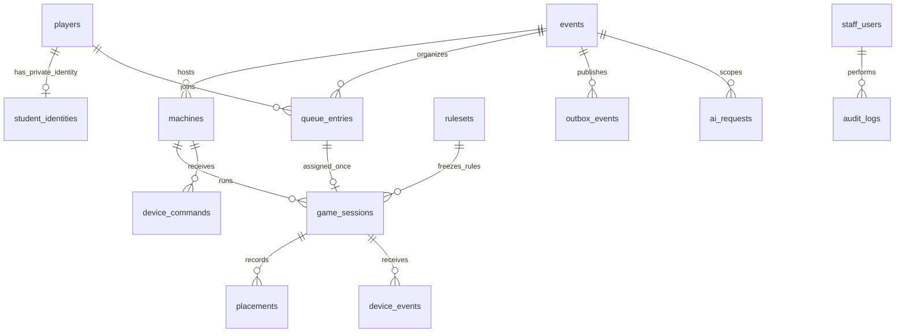

> Current implementation: QR entry, persistent private queue/tickets, admin login and neutral admin light/dark themes now exist. See [player flow and access update](player-flow-and-access.md) for the current behavior, API, migrations and limits. Earlier preview-only statements below are historical.

# Stack Moko Baby — MySQL data model

15 November 2026 · Candidate DDL: [schema.sql](schema.sql). Target: **XAMPP MySQL service — installed MariaDB 10.11.16**, InnoDB, utf8mb4 with `utf8mb4_unicode_ci`. See verification.md for isolated schema checks; the existing XAMPP databases are not modified by this documentation task. Alembic migrations become authoritative during implementation; keep this reference synchronized with them.

## 1. Conventions

- Internal keys: `BIGINT UNSIGNED`; external IDs: application-generated UUID strings with ASCII binary collation. `public_code` is random and unrelated to student ID. Codes are public labels, never authentication credentials.
- Time: `DATETIME(3)` in UTC, every application connection sets `time_zone='+00:00'`. Convert user-facing ranges from Asia/Manila using timezone-aware application code. Use half-open `[start,end)` ranges; never filter using an assumed host timezone.
- All foreign keys default to restrictive deletion. Anonymization retains aggregate game evidence; identity cleanup is explicit and transactional.
- JSON is reserved for immutable rules, bounded device envelopes, safe audit/notification metadata and configuration. Core ranking and identity fields are typed columns.
- Hash fields are raw 32-byte values. Hash canonical validated payloads using a specified stable JSON serialization, not raw HTTP bytes.
- MySQL constraints enforce basic integrity; cross-row rules, legal state transitions, immutable rulesets, event authorization and scoring replay remain service responsibilities.

## 2. Entity relationships



`auth_sessions` binds one private browser session to exactly one player or staff user. `request_receipts` supplies operation-level idempotency without retaining raw registration input.

| Table | Important fields and purpose |
|---|---|
| `events` | Window, timezone, admission status, settings, monotonically increasing revision. |
| `players` | Public UUID/code, nickname, privacy notice acknowledgment; no student ID. |
| `student_identities` | One private identity per player; institution-scoped keyed lookup, encrypted ID, nonce/tag/key versions and purge date. |
| `staff_users` | Argon2id hash, operator/admin role and enabled flag. |
| `auth_sessions` | Hashed opaque token and CSRF token, exactly one principal, expiry/revocation. |
| `rulesets` | Unique version code, canonical config/hash, author; insert-only after publication. |
| `machines` | Event binding, hashed device token, last seen, boot/uptime, observed state and bounded health JSON. |
| `queue_entries` | FIFO ordering; generated live-player key prevents duplicate waiting/assigned tickets per event. |
| `game_sessions` | Player/queue/machine binding, frozen rules, state/revision, result evidence hash, validated metrics and invalidation metadata. |
| `placements` | Ordered attempted rows, position/width/support/overlap and elapsed time; enough to reproduce score and accuracy. |
| `device_events` | Deduplicated start/progress/interruption receipts with payload hash. Progress events are optional and never the sole final evidence. |
| `device_commands` | Durable reserve/abort/reconcile/maintenance commands, expected revision, delivery/application receipts. |
| `request_receipts` | Actor/operation/key unique; request hash and safe response metadata. Never store ID or plaintext session token in response JSON. |
| `audit_logs` | Append-only staff action trail with redacted metadata and reason. |
| `ai_requests` | Scope, policy/model version, tool names, result status, latency/tokens; raw prompt/answer retention disabled by default. |
| `outbox_events` | Transactional notification with event revision and retry tracking. |

## 3. Important constraints

`game_sessions.active_machine_id` is a stored generated value for `reserved`, `countdown`, `playing`, `awaiting_result` and `review`; it is null otherwise. A unique index allows multiple historical rows with null active keys, but only one active session per machine. `queue_entries.live_player_id` similarly provides uniqueness for waiting/assigned tickets per event. This MySQL-compatible design uses [MariaDB generated columns and indexes](https://mariadb.com/docs/server/reference/sql-statements/data-definition/create/generated-columns), not a PostgreSQL partial index.

Composite foreign keys bind a session to a machine from the same event and a queue entry with the same event and player. A queue entry can be assigned to at most one session. Command and device-event composite keys prevent accidental cross-machine session references. A machine cannot be reassigned to another event while its referenced historical rows exist; provision a new machine/event binding record for a new event, or introduce a dedicated machine-event assignments table in a later migration.

Completed sessions require outcome, receipt/hash, timing and metrics. Placement order and level are unique per session. [CHECK constraints](https://dev.mysql.com/doc/refman/8.4/en/create-table-check-constraints.html) guard positive widths and plausible numerator ranges, while replay validates board-specific bounds and legal timing. The schema deliberately does not hardcode `classic-v1`'s 12 levels/1,500 points into all historical sessions.

## 4. Required transactions

### Join queue

Check authenticated player/event access. Attempt insertion under `uq_live_ticket`; on duplicate, return the player's existing live ticket. Bind the idempotency receipt to player and `join_queue`, not the public code. A registration request hash containing a student ID must use a keyed digest so receipt storage does not become an offline ID guessing oracle.

### Call next

Within one transaction: lock event row to validate admissions and allocate revision; lock machine row with `SELECT ... FOR UPDATE`; verify availability and freshness; lock the oldest waiting entry using `(event_id,status,joined_at,id)`; create session, update queue to assigned, write reserve command, safe audit/receipt and outbox row; commit. Use a single consistent lock order across all related operations: event → machine → queue → session. For operations starting with a session ID, first read its immutable IDs without locking, then acquire this ordered set and recheck state/revision.

`SKIP LOCKED` is optional when multiple machines consume a queue; it can temporarily skip a locked earlier entry. A single machine can use ordinary locking for strict FIFO. InnoDB requires explicit transactions for useful locking reads. Handle deadlocks with bounded retry; never hold the transaction while talking to a device. [Locking-read reference](https://dev.mysql.com/doc/refman/8.4/en/innodb-locking-reads.html).

### Commit result

Authenticate the bound machine; lock in the same order; if session already has a terminal ID/hash, same ID + same canonical payload returns prior success. Different evidence is a conflict and audit/review alert; do not overwrite a valid result. Validate rules hash and replay all placements. Insert final placements and computed totals, set completed, set served, advance event revision, create outbox/receipt, commit, then ACK. Any error rolls back the whole unit.

Terminal upload may arrive before separately uploaded start/progress events. Replay final evidence and session binding; complete through permitted reconciliation without requiring optional progress rows. Later delayed events may be retained as historical observations but must never move a completed state backward.

### Invalidate / reconcile

Admin invalidation records actor/time/reason without deleting the score or trace, advances revision and refreshes rankings. Uncertain active sessions remain `review`, retaining the unique machine lock. Clear the lock only after matching device state or audited physical recovery; close the queue entry as cancelled/expired as appropriate. Never change a result solely to satisfy a timeout.

## 5. Query examples and metric definitions

Bind all parameters using SQLAlchemy; examples are application templates, not strings for AI-generated SQL. Every analytics query includes event, ruleset and UTC completion range.

### One best game per player; deterministic ranks

```sql
WITH best AS (
  SELECT s.*,
    ROW_NUMBER() OVER (
      PARTITION BY s.player_id
      ORDER BY s.score DESC, s.highest_level DESC, s.duration_ms ASC,
               s.completed_at ASC, s.id ASC
    ) AS personal_order
  FROM game_sessions s
  WHERE s.event_id = :event_id AND s.ruleset_id = :ruleset_id
    AND s.status = 'completed' AND s.invalidated_at IS NULL
    AND s.completed_at >= :start_utc AND s.completed_at < :end_utc
)
SELECT ROW_NUMBER() OVER (
         ORDER BY b.score DESC, b.highest_level DESC, b.duration_ms ASC,
                  b.completed_at ASC, b.id ASC
       ) AS ranking,
       p.public_code, p.nickname, b.score, b.highest_level, b.duration_ms
FROM best b JOIN players p ON p.id = b.player_id
WHERE b.personal_order = 1
ORDER BY ranking
LIMIT :limit;
```

### Summary

```sql
SELECT COUNT(*) AS completed_games,
       COUNT(DISTINCT player_id) AS players,
       COALESCE(SUM(outcome = 'win'), 0) AS wins,
       COALESCE(SUM(outcome = 'loss'), 0) AS losses,
       100.0 * SUM(outcome = 'win') / NULLIF(COUNT(*), 0) AS win_rate_pct
FROM game_sessions
WHERE event_id = :event_id AND ruleset_id = :ruleset_id
  AND status = 'completed' AND invalidated_at IS NULL
  AND completed_at >= :start_utc AND completed_at < :end_utc;
```

### Placement failures by level

```sql
SELECT p.level_no, COUNT(*) AS attempted_sessions,
       SUM(p.overlap_width = 0) AS zero_overlap_failures,
       100.0 * SUM(p.overlap_width = 0) / NULLIF(COUNT(*), 0) AS failure_rate_pct
FROM placements p JOIN game_sessions s ON s.id = p.session_id
WHERE s.event_id = :event_id AND s.ruleset_id = :ruleset_id
  AND s.status = 'completed' AND s.invalidated_at IS NULL
  AND s.completed_at >= :start_utc AND s.completed_at < :end_utc
GROUP BY p.level_no ORDER BY p.level_no;
```

Timeouts have their own outcome breakdown using `end_reason='timeout'`; do not add an imaginary placement. Overall overlap accuracy is the pooled ratio `100*SUM(overlap_total)/NULLIF(SUM(attempted_width_total),0)`; a mean of per-game percentages is a different metric and must be labeled separately. Empty denominators produce null/“N/A”, not 0%.

## 6. Identity, retention and backups

HMAC lookup is over `institution_code + separator + normalized_id` with a server-held key. A plain SHA-256 of predictable student numbers is inadequate. The student ID is encrypted separately; neither lookup nor ciphertext is sent to public browsers or AI. Required student ID entry is an identification requirement, not evidence the person owns that ID. Operator-assisted duplicate recovery is the baseline until stronger verification is chosen.

During HMAC key rotation, the application computes candidates under all active versions and searches before insertion; otherwise the same student can acquire duplicates across key versions. The initial one-row-per-player design requires transactional staged re-keying from decryptable IDs, with duplicate detection before retiring the old key. Key rotation must have a tested recovery plan.

Retention proposal: purge identity after 30 days following event close; redact/anonymize nicknames on request or at the approved retention point; retain anonymous scores only if the institution permits it. Student identity is global across events: extend `purge_after` for a legitimately returning participant under an acknowledged policy, or use event-scoped identities if the institution requires per-event deletion. Expire browser sessions; remove sensitive records from restore copies through a documented backup lifecycle. HMAC mappings remain identifying data even after ciphertext deletion and must be purged too.

Keep application roles from updating rulesets and audit history through ordinary endpoints. A migration operator may have elevated DB rights. Test encrypted backup restoration and key availability separately; never place real backups, CSV exports, environment files or telemetry dumps into the project knowledge graph.

## 7. Validation required before first migration

Apply DDL to an isolated MariaDB instance matching the installed XAMPP version; run constraint and concurrent-transaction tests, result replay conflict tests, FK cross-event rejection, identity cleanup and ranking fixtures. Run `ANALYZE FORMAT=JSON SELECT ...` (MariaDB) or `EXPLAIN SELECT ...` on realistic event data before adding further indexes. This planning task supplies a candidate schema, not a production migration or a claim that these database checks passed.

## 8. XAMPP compatibility

The XAMPP **MySQL** button controls MariaDB in the inspected installation. The schema uses `utf8mb4_unicode_ci`, rather than an Oracle-MySQL-specific 0900 collation. MariaDB supports the stored generated columns, CHECK constraints and window functions used here; validate locking and migrations on the actual installed version. MariaDB represents JSON differently from Oracle MySQL, so do not assume binary-JSON storage behavior. [Generated columns](https://mariadb.com/docs/server/reference/sql-statements/data-definition/create/generated-columns), [ROW_NUMBER](https://mariadb.com/docs/server/reference/sql-functions/special-functions/window-functions/row_number).
