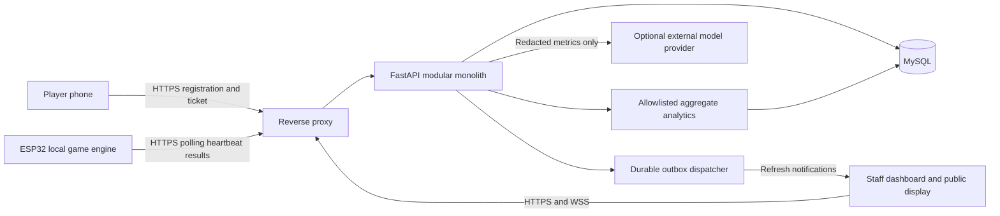

> Current implementation: QR entry, persistent private queue/tickets, admin login and neutral admin light/dark themes now exist. See [player flow and access update](player-flow-and-access.md) for the current behavior, API, migrations and limits. Earlier preview-only statements below are historical.

# Stack Moko Baby — tech stack and architecture

## Local NLP implementation update — 17 November 2026

The admin chat now calls FastAPI for local Ollama intent interpretation using `qwen3:4b-instruct`. Existing pinned HTTPX/Pydantic dependencies handle bounded loopback HTTP and strict schemas; no cloud SDK, vector database or extra NLP dependency is required. Approved vocabulary and typed context reach the model; database rows/raw history never do. A shared MariaDB repeatable-read READ ONLY service powers both deterministic Analytics charts and chat templates. Fixed queries have per-statement limits; existing `ai_requests` stores safe metadata in a separate transaction. Migration 003 adds private structured `ai_admin_memory`; analytics itself adds no table. Status, analytics, preparation, private-memory and query routes are admin-authorized; preparation/query POSTs and memory DELETE require CSRF. A 120-second background calibration handles cold loading, while normal questions retain their 20-second deadline. Ollama returns a strict topic; the backend maps it to approved analytics and selects bilingual factual templates. Ollama availability does not affect ordinary startup/health. See [implementation, contracts, setup and targeted validation](admin-assistant.md). The current Python environment is 3.13; older baseline recommendations below are historical where superseded.

Version 0.1 · 15 November 2026. Recommendations below are engineering decisions for the documented baseline; installed application dependencies must be pinned during scaffolding.

## 1. Selected stack

| Layer | Baseline | Purpose and tradeoff |
|---|---|---|
| Web | React, JavaScript (JSX), Vite; CSS variables/CSS modules; React Router; TanStack Query planned for backend integration | Use Vite’s `react` JavaScript template, `.jsx` components and `.js` modules; JSDoc is optional. Mobile registration, post-completion player leaderboard and staff dashboard. A client-rendered app is sufficient for an event; no SSR needed. |
| UI | Shared CSS design tokens, Radix primitives, standard Font Awesome webfont icons, Recharts for trends/distributions; data gauge | The initial UI uses locally hosted fonts and standard font icons, with no SVG icon renderer. Preserve Sourcio proportions through shared components. Install exact compatible releases and lock them. |
| Server | Python 3.12, FastAPI, Pydantic v2, Uvicorn | Typed HTTP contracts, authorization and browser WebSockets. [FastAPI documents WebSocket dependencies and disconnect handling](https://fastapi.tiangolo.com/advanced/websockets/). |
| Persistence | XAMPP MySQL service (installed MariaDB 10.11.16), InnoDB, utf8mb4; SQLAlchemy 2.x and Alembic | Transactional assignment, replay-safe results and versioned migrations. Use a tested SQLAlchemy 2.0/2.1 combination, pinned at implementation. |
| DB driver | PyMySQL via synchronous SQLAlchemy sessions | Simple first release. Keep database-bound handlers synchronous or in worker threads; do not block the async WebSocket loop. [Driver options](https://docs.sqlalchemy.org/en/20/dialects/mysql.html). |
| Firmware | C++ with PlatformIO and ESP32 Arduino framework, deterministic game engine | Familiar embedded workflow; a pure engine can compile as native tests and be replayed by backend fixtures. Board/framework versions depend on the selected hardware. |
| Matrix | ESP32-HUB75-MatrixPanel-DMA with Adafruit GFX | Candidate driver for HUB75 panel, subject to exact panel/chip validation. The library documents supported ESP32 variants, scan types and driver limitations. [Driver source](https://github.com/mrcodetastic/ESP32-HUB75-MatrixPanel-DMA). |
| Device link | HTTP/S polling and POSTs, JSON v1 contracts | Fewer services than MQTT for a single cabinet. Device gameplay does not depend on a persistent socket. |
| Browser live link | WebSocket notification plus REST snapshots | Notify after commit, invalidate cached data, recover through snapshot on reconnect. |
| AI | Server-side provider adapter using schema-constrained tool calls | Provider/model is an open procurement decision. Never put provider keys in the frontend or device. No vector database is needed for structured game metrics. |
| Staff auth | Argon2id password hashes; opaque, hashed server-side sessions in secure HttpOnly cookies | Roles on every staff endpoint. Add CSRF protection to cookie-authenticated writes. |
| Private identity | HMAC-SHA-256 lookup, AES-256-GCM encrypted student ID | Separate keys and key versions; random nonce per encryption; authenticated metadata includes player ID and key version. |
| Hosting | Windows event PC on dedicated LAN; XAMPP database service; native FastAPI/Uvicorn; HTTPS reverse proxy | Keep core gameplay/registration working without internet. AI may require internet. Start the database through the XAMPP Control Panel. Docker/WSL2 is not required. XAMPP Apache can serve the built frontend and proxy the API after HTTPS configuration; it is optional during Vite development. |
| Tests | pytest + XAMPP/MariaDB integration tests, Vitest, Playwright, native firmware tests and physical hardware checks | SQLite is not a substitute for testing MySQL locking or generated constraints. |
| Project map | Graphify (`graphifyy`) in isolated local environment | Development context only, separate from runtime analytics and MySQL. See [setup](graphify-setup.md). |

Use exact lockfiles, a recorded Python/Node version and the recorded XAMPP/MariaDB server version at scaffold time. Vite's documented Node requirements must be checked when choosing a release; do not assume any preinstalled Node will be compatible. [Vite setup](https://vite.dev/guide/).

## 2. Architecture and ownership



Firmware owns immediate timing, row movement, button input, LEDs, audio and durable terminal evidence. Server owns identity, queue fairness, session authorization, immutable rules, validation, ranking and audit history. Browser is a view/controller for permitted staff actions; it cannot grant a device turn or author a score. MySQL is the committed system of record. AI explains server-calculated data and has no place in the control loop.

Start as a modular monolith: `identity`, `auth`, `events`, `machines`, `queue`, `sessions`, `rules`, `leaderboard`, `analytics`, `ai`, `audit`, `outbox`. One API process/worker plus an in-process outbox polling task is adequate for the initial LAN workload. FastAPI's in-memory connection list is process-local; before multiple workers, add a shared notification transport or separate broadcaster. Do not increase worker count without addressing this.

## 3. Proposed repository layout

```text
D:\iot-dashboard\
  docs/                         # This specification set
  frontend/src/{app,pages,components,features,styles}/
  backend/app/{api,auth,models,services,analytics,ai,workers}/
  backend/alembic/               # Authoritative migrations once implementation begins
  backend/tests/
  firmware/{src,include,test}/
  contracts/{openapi,fixtures}/  # OpenAPI contracts and shared scoring vectors
  infra/                        # XAMPP, proxy and deployment settings
  scripts/                      # Backup, restore, Graphify helpers
  graphify-out/                 # Generated project context; no real player data
  AGENTS.md
  .env.example                  # Names only, dummy values
```

## 4. Deployment and configuration

Only the proxy exposes HTTPS to player devices; keep Uvicorn and the XAMPP database on the local host. Bind MariaDB to `127.0.0.1` and do not expose port 3306 or phpMyAdmin to player devices. Bind services deliberately and allow the selected LAN only in Windows Firewall. Use a DHCP reservation for the server and a tested stable DNS name. All phones and ESP32 must reach that hostname with client isolation disabled on the event network. Print a QR only after a real phone reachability test.

TLS is required when transmitting student IDs/credentials. For an isolated LAN, use an institution-managed certificate/trust setup or a valid publicly trusted certificate for an owned DNS name resolving privately. A local CA can work only when clients trust it; verify participant-phone feasibility. Plain HTTP development must use synthetic IDs. Do not work around certificate failures by disabling verification. Espressif's HTTP client supports certificate validation and HTTPS; perform networking off the game loop. [ESP HTTP client](https://docs.espressif.com/projects/esp-idf/en/stable/esp32/api-reference/protocols/esp_http_client.html).

Settings: database URL; public base URL; allowed origins; cookie security; identity encryption and HMAC keys/versions; session lifetimes; device tokens; event timezone; AI model/key/budget; heartbeat/stale thresholds; redacted logging and retention. Keep secrets outside source control and Graphify inputs. DB accounts: migration owner, constrained application account, backup account; the AI has no database account. Backup files contain sensitive data and require encryption and controlled access.

### XAMPP database setup

The local installation at `C:\xampp` reports `MariaDB 10.11.16`; XAMPP labels this service **MySQL** in its Control Panel. Use the installed engine as the compatibility target, rather than assuming Oracle MySQL 8.4. [XAMPP engine explanation](https://www.apachefriends.org/faq_windows.html).

1. Start **MySQL** in XAMPP Control Panel. The inspected `mysql/bin/my.ini` sets port **3306**; confirm the live port if local configuration changes.
2. Import `docs/schema.sql` into an empty development database through local phpMyAdmin or the XAMPP database command-line client. During implementation, apply Alembic migrations instead of repeatedly importing the reference DDL.
3. Create a dedicated application user limited to `stack_moko_baby`. Use a separate migration account for schema changes. Root access is for local administration; never configure the app with a blank/root account.
4. Keep the backend in `D:\iot-dashboard\backend`; XAMPP is the database host and does not require moving Python into `htdocs` or replacing FastAPI with PHP.
5. Configure the backend using `mysql+pymysql://stack_app:<url-encoded-password>@127.0.0.1:3306/stack_moko_baby?charset=utf8mb4`. This is a configuration template, not a real credential. Frontend/ESP32 communicate only with FastAPI; they never connect directly to the database.

Use `utf8mb4_unicode_ci` in the schema for MariaDB compatibility. The `mysql+pymysql` SQLAlchemy dialect supports MariaDB. Keep phpMyAdmin local and enable HTTPS for player-facing registration before entering real IDs. No existing XAMPP databases or user accounts are changed by this documentation update.

## 5. HTTP contracts

Current implemented routes use `/api`; see [player flow](player-flow-and-access.md) and [device command delivery](device-command-delivery.md). The table below is the broader proposed route catalog, not a claim that every route is implemented. A versioned `/api/v1` prefix remains a proposal. UUID strings are external identifiers; numeric IDs are internal. For the proposed versioned catalog, writes should require an `Idempotency-Key` except explicitly idempotent PUT/DELETE operations. Current device command receipts instead deduplicate their canonical validated body under the durable command UUID; current call-next uses its existing request-key receipt. Persist the operation's key and canonical request hash in the corresponding row/receipt; do not rely on an expiring in-memory cache. Scope keys to authenticated actor and operation. Duplicate same request returns the prior result; different payload under the same key returns `409`.

| Method and path | Actor | Contract |
|---|---|---|
| `POST /registrations` | Public, rate-limited | Student ID + nickname + event/machine code + notice version; return generic next-step response and private session cookie. Never echo ID. |
| `POST /queue` | Player session | Create/reuse live ticket for event. Return ticket UUID, position and state. |
| `GET /me/ticket` | Player session | Own ticket snapshot only. |
| `DELETE /me/ticket` | Player session | Cancel waiting ticket; assigned ticket requires operator reconciliation. |
| `GET /events/{code}/leaderboard` | Public | Event/ruleset/date scope, public fields only, cursor/limit. |
| `GET /admin/overview` | Staff | Metric values, denominators, window, freshness and machine state. |
| `GET /admin/sessions` | Staff | Filtered/paginated sessions; private identity omitted by default. |
| `POST /admin/machines/{id}/call-next` | Operator | Atomic queue reservation; return session and durable command ID. |
| `POST /admin/sessions/{id}/abort` | Operator | Reason + expected revision; enqueue command, never pretend it already applied. |
| `POST /admin/sessions/{id}/invalidate` | Admin | Reason + expected revision; retain evidence and emit ranking refresh. |
| `POST /admin/rulesets` | Admin | Validate and create immutable future ruleset; cannot alter current round. |
| `POST /admin/analytics/ask` | Staff | Bounded question and selected scope; aggregate-tool answer or explicit unavailability. |
| `GET /device/commands` | Device | Own unacknowledged commands; repeated polls return same command. |
| `POST /device/commands/{id}/ack` | Device | Durable accepted/rejected/applied receipt, matching session and revision. |
| `POST /device/heartbeat` | Device | Boot ID, monotonic uptime, firmware/rules hash, local state, active session and last terminal ID; optional Wi-Fi RSSI. |
| `POST /device/sessions/{id}/events` | Device | Durable start/countdown and optional row events with sequence and event UUID. |
| `POST /device/sessions/{id}/result` | Device | Full final placements, duration, outcome, rules hash and terminal ID. |
| `GET /health/live`, `GET /health/ready` | Monitor | Process live versus DB/migration ready; no secrets or private data. |

Use `401/403` for authentication/authorization, `409` for state or idempotency conflict, `422` for invalid rules/results, `429` for rate limits and `503` for unavailable dependencies. Structured errors include safe code, message, request ID, retryability and current revision where appropriate. Bound request bodies (proposed 32 KB result, 2 KB question, at most 12 placements), pagination and per-actor rates.

Example device result (IDs shortened for readability; real identifiers are UUIDs):

```json
{
  "protocol_version": 1,
  "terminal_id": "uuid",
  "boot_id": "uuid",
  "ruleset_hash": "sha256-of-canonical-rules",
  "expected_session_revision": 3,
  "outcome": "loss",
  "end_reason": "zero_overlap",
  "duration_ms": 14620,
  "placements": [
    {"seq": 1, "level": 1, "candidate_x": 2, "candidate_width": 3,
     "overlap_width": 3, "locked_at_ms": 1210}
  ]
}
```

This is a shape example, not a valid complete loss trace. Backend reconstructs every support interval, width, score and outcome from a complete trace; a reported total is only diagnostic. Validate timestamps, legal positions/movement timing and row count against rules; placement gaps must permit the stated movement schedule. Canonicalize validated JSON before hashing, excluding transport headers and server receipt time. Authenticated device evidence establishes a cabinet record, not proof against a physically compromised controller.

## 6. Reservation, acknowledgment and replay

Implemented portion, 19 November 2026: command polling and durable accepted/rejected receipts, accepted-receipt start gating, command diagnostics and conservative review holds. The remaining boot/terminal/reordered-event reconciliation described below is still proposed. See [exact contract and verified boundaries](device-command-delivery.md).

1. Transaction locks machine row, checks enabled/idle/freshness and absence of an active session; locks oldest waiting queue row. Create session with frozen ruleset and queue assignment plus command/outbox records. Commit before delivery. [InnoDB locking reads](https://dev.mysql.com/doc/refman/8.4/en/innodb-locking-reads.html) support this serialization.
2. Device persists session ID, rules hash and command ID before acknowledging. Same command is acknowledged again without starting another round.
3. Device writes a durable start marker before countdown; retry its state event until accepted. Server may receive final result before start acknowledgment and must reconstruct allowed transitions using the terminal evidence rather than discarding an otherwise valid result.
4. On terminal state, persist one complete record locally before upload. Server locks session, validates bound machine/rules/trace, writes placements/result, marks queue served, inserts outbox notification and commits atomically.
5. ACK final result only after commit. Device clears its pending record only after this ACK and advances local state. If ACK is lost, same terminal ID/hash returns the original receipt. A conflict preserves original data and raises review.
6. Unknown-start timeout never frees the machine blindly. Reconcile local persisted session/boot/terminal markers. Expire an unstarted reservation only with matching device evidence; otherwise review or physical operator reconciliation is required.

Bounded exponential backoff with jitter (proposed 1–30 seconds) applies to uploads. Command polling: 1 second idle/reserved; heartbeat: 5 seconds, coalesce active progress at most 2 updates/sec. No database transaction stays open during network I/O. Deadlocks cause bounded transaction retries. Proposed final-result timeout is 90 seconds after last activity, leading to review, never automatic reassignment.

NVS is suitable for small durable key/value state; size a versioned, checksummed journal for a full terminal record and test power cuts during writes. Avoid per-frame flash writes. [Espressif NVS documentation](https://docs.espressif.com/projects/esp-idf/en/stable/esp32/api-reference/storage/nvs_flash.html).

## 7. Browser synchronization

Implemented 19 November 2026: `WS /api/live/admin` and `/api/live/player` authenticate separate staff/player cookies and validate Origin. There is no public channel. Frames contain only `type` (`ready`, `invalidate`, `heartbeat`) and global event `revision`; no entity identifiers, scores or identity data are broadcast. Authorization is rechecked on every frame and 15-second keepalives. Unsupported client messages close the channel. See [durable browser updates](live-updates.md).

REST snapshots include coherent `revision`/`generatedAt` from short repeatable-read transactions. Mutations increment `events.revision` and insert outbox rows atomically. A lifespan dispatcher polls committed pending rows every 250 ms and coalesces safe hints into bounded subscriber queues. Subscribe before refetching, deduplicate by revision, reject older snapshots and refetch gaps/reconnects. Published means queued, not browser-acknowledged. Poll every 2 seconds while unavailable and 15 seconds while live; focus/actions refresh immediately. Keep one API worker until shared routing exists. The unlocked player leaderboard remains authorized.

## 8. Observability and boundaries

Structured logs use request/session/command IDs, latency and safe error codes. Redact student IDs, cookies, authorization, encryption keys and AI prompt text. Monitor queue wait, valid results, replay conflicts, pending uploads, stale machines, outbox lag, DB health and AI availability. A dashboard outage cannot interrupt the local active round. AI failure leaves charts and rule-based aggregates available.

Back up before event opening and daily during the event, verify restoration separately, and retain migration/version/firmware hashes with each release. A local PC is a single point of failure; UPS, spare cables/button and printed recovery instructions are appropriate for the showcase. Scale to MQTT/shared pub-sub/cloud only after a demonstrated operational need.


## Grounded conversation memory — 18 November 2026

Local inference now routes natural system questions to reviewed public knowledge cards as well as analytic topics and social acts. The backend composes all factual prose; no arbitrary document loading or model-written system facts are allowed. `ai_admin_memory` stores only server-owned, schema-validated topic/filter context and preferences per staff account; recent hints are capped at six. Explicit new subjects override memory, and current metrics always use fresh read-only analytics. Memory persistence is a separate bounded write path, protected by optimistic revisions and empty tombstones on Forget. Raw text, player records and metric values do not enter memory/model context. This is contextual adaptation, not fine-tuning. See the assistant guide for endpoints, migration and actual test evidence.


## Reviewed routing dataset preparation — 18 November 2026

A separate `TrainingStore` uses migration 004, owner-scoped fixed SQL and strict normalized-input/routing-target schemas. Chat returns only a volatile candidate; collection requires explicit UI selection and cannot be invoked by the model. Pending/review/approval is distinct from private memory and numerical analytics. Approval requires the latest row revision, explicit review confirmation and the current prompt/normalizer/schema/knowledge/vocabulary version. Export includes only approved current-version samples as role/content JSONL, with no raw transcript, answer or game records. The existing Radix modal and Font Awesome webfonts provide the review UI. No training framework, weight update, cloud service or new Ollama model was added. See [workflow, API and validation](assistant-training.md).


## Quality hardening — 19 November 2026

The [audit](quality-audit.md) adds a pure ASGI 64 KiB request-body limit (including chunked input), strict typed/UTF-8 API inputs, configured-origin checks, revoked player-cookie rotation and stronger database readiness. PyMySQL connect/read/write timeouts are five seconds; browser requests combine cancellation with a 15-second deadline, or 25 seconds for assistant queries. A timeout does not prove a mutation failed; clients must refresh before retrying.

Dashboard and AI cabinet state now share one definition including disabled/maintenance cabinets, stale device observations, disabled simulator source and review-held assignments. Terminal replay rejects duration inflation. Rankings explicitly select a source; unattempted ratios stay N/A. QR files use a locally bundled `qr-scanner` fallback after html5-qrcode rejects a readable image; both libraries are pinned, and no uploaded image leaves the browser. Vite development and preview respect the same `STACK_API_TARGET`.

The audit includes actual process restart, 50 loopback browser clients and synthetic XAMPP restoration. These are local software checks, not event-LAN, physical ESP32 or production deployment acceptance.
